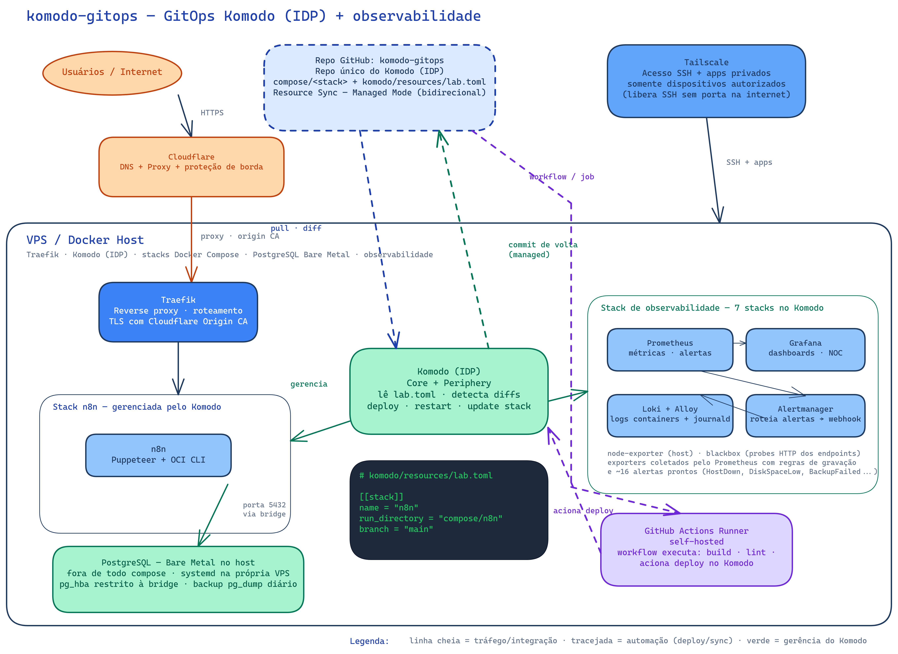

# komodo-gitops

Infraestrutura self-hosted em Docker Compose, gerenciada via GitOps pelo Komodo (IDP). Este repo é a fonte declarativa que o Komodo consome: stacks de automação e observabilidade versionadas aqui, sincronizadas em modo bidirecional (Managed Mode) — push no Git gera diff/deploy no IDP, e mudança feita na UI do Komodo volta como commit no repo.

## Arquitetura



*Fonte editável: [docs/arquitetura.excalidraw](docs/arquitetura.excalidraw) — abre no [excalidraw.com](https://excalidraw.com) ou na extensão Excalidraw do VS Code.*

## Componentes

| Componente | Responsabilidade | Exposição |
| --- | --- | --- |
| Cloudflare | DNS, proxy, proteção de borda | Pública |
| Traefik (no host) | Terminação TLS na origem (Origin CA) e roteamento; rotas de observabilidade em [docs/traefik-core-file-provider.yml](docs/traefik-core-file-provider.yml) | Pública, somente HTTPS |
| n8n | Automação — imagem custom com Puppeteer e OCI CLI, Postgres como banco | Via Traefik |
| Stack de observabilidade | Prometheus (métricas, recording rules, ~16 alertas), Grafana (dashboards NOC/Traefik/hosts/backup), Loki + Alloy (logs de containers e journald), Alertmanager (roteamento via webhook), node-exporter e blackbox (exporters) | Privada via Tailscale |
| PostgreSQL | Persistência em Bare Metal — systemd no host, fora de todo Compose ([docs/postgres-bare-metal.md](docs/postgres-bare-metal.md)) | Bridge Docker local, pg_hba restrito |
| Komodo (IDP) | Declaração e gerência das stacks a partir de [komodo/resources/lab.toml](komodo/resources/lab.toml) | Privada via Tailscale |
| GitHub Actions + Runner | CI: build e lint; deploy acionando o Komodo | Runner privado na VPS |
| Tailscale | SSH e acesso administrativo sem portas na internet | Dispositivos autorizados |

## Fluxo GitOps (bidirecional)

- **Git → Komodo:** o Resource Sync do Komodo polla este repo (`komodo/resource-sync.toml`); qualquer mudança em `compose/` ou em `lab.toml` aparece como diff de recursos no IDP. Stacks novas entram com `deploy = false` (detecta diff sem aplicar) e passam a `true` quando validadas.
- **Komodo → Git:** com `managed = true`, qualquer edição feita na UI do Komodo (tag de imagem, env, variável de stack) é escrita de volta em `lab.toml` como commit neste repo. O Git permanece a fonte da verdade.

## Estrutura do repo

```text
.
├── compose/
│   ├── n8n/                     # compose.yaml + Dockerfile + .env.example
│   ├── monitoring/              # stack de observabilidade (7 pastas)
│   │   ├── prometheus/          # prometheus.yml, alerts.yml, recording-rules.yml
│   │   ├── grafana/             # dashboards/*.json, ldap.toml.example
│   │   ├── loki/                # config.yaml, rules/ (alerta por log)
│   │   ├── alloy/               # coletor de logs
│   │   ├── alertmanager/        # alertmanager.yml, cliq-bot.deluge
│   │   ├── node-exporter/
│   │   └── blackbox/            # blackbox.yml (probes HTTP)
│   ├── komodo/                  # o próprio Komodo (core + mongo + periphery)
│   └── data/                    # placeholders de volume (services/n8n/...)
├── komodo/
│   ├── resources/lab.toml       # servidor + 9 stacks declarados (arquivo único, Managed Mode)
│   ├── resource-sync.toml       # o Resource Sync (managed = true)
│   └── README.md                # como importar no Komodo pela primeira vez
├── docs/
│   ├── postgres-bare-metal.md
│   ├── traefik-core-file-provider.yml
│   └── arquitetura-proposta.*   # diagrama Excalidraw editável + PNG
└── .gitignore
```

## Estado do projeto

- **Versionado e pronto:** composes de n8n, Komodo e observabilidade; TOMLs do Resource Sync; dashboards e regras de alerta; doc de Bare Metal do Postgres; diagrama de arquitetura.
- **A preencher antes de subir:** `TODO` do endereço/nome do Periphery em `lab.toml`; `.env` de cada stack (a partir dos `.env.example`); placeholders `<IP_*>` e domínios `.example.local` dentro de `compose/monitoring/` (lista completa no [README da pasta](compose/monitoring/README.md)).

## Segredos

Nunca commitar: `.env` real, tokens da Cloudflare ou GitHub, chaves do Tailscale, certificados TLS, credenciais de banco, dumps e dados persistentes. Os arquivos `*.example` e os placeholders `<IP_*>`/`<SEU_CANAL_CLIQ>` existem justamente por isso — o conteúdo interno do ambiente de referência foi higienizado na importação.
