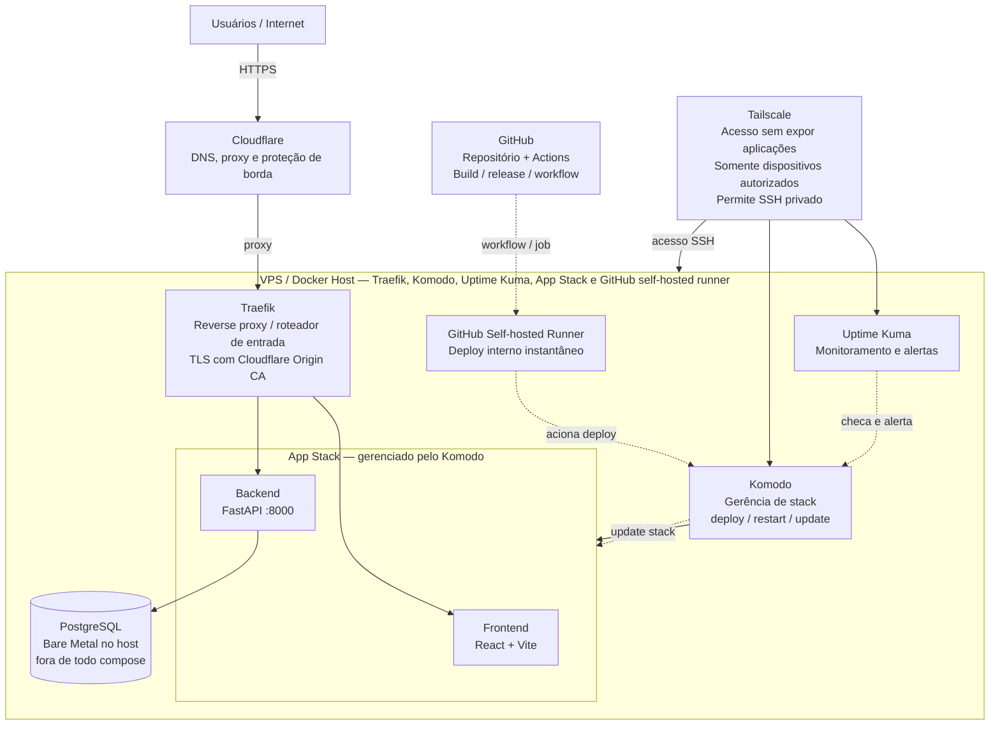

# DevOps Homelab

Infraestrutura auto-hospedada para publicar aplicações web com HTTPS, deploy automatizado, monitoramento e acesso administrativo privado. A orquestração é GitOps self-hosted: declaração em Docker Compose versionado, gerência via Komodo (IDP) e deploys acionados por Git.

O objetivo de um blueprint de referência funciona para qualquer stack (frontend + backend + banco). O desenho abaixo usa, como aplicação de exemplo, um **frontend React + Vite** e um **backend FastAPI** (porta interna 8000) — troque pelos containers da aplicação em questão sem alterar as demais camadas.

## Arquitetura



> **Blueprint genérico**: o desenho usa React + FastAPI como exemplos de frontend/backend, e PostgreSQL como banco. Qualquer stack entra no quadrado da App Stack sem mover Cloudflare, Traefik, Komodo, runner ou Uptime Kuma — e o fluxo de deploy continua o mesmo, disparado pelo Git.


## Componentes

| Componente | Responsabilidade | Exposição |
| --- | --- | --- |
| Cloudflare | DNS, proxy, TLS de borda e proteção | Pública |
| Traefik | Terminação TLS na origem (Origin CA) e roteamento para containers | Pública, somente HTTPS |
| App Stack | Containers da aplicação (ex.: frontend React + Vite, backend FastAPI :8000) | Pública via Traefik |
| PostgreSQL (Bare Metal) | Persistência via systemd no próprio host, fora de todo Compose | Privada, acessível apenas pela bridge Docker |
| Komodo | Gerência da stack: deploy, restart e update via Git | Privada via Tailscale |
| GitHub Actions | Build, release e orquestração do deploy | GitHub |
| Self-hosted Runner | Executor interno dos workflows, acionando o Komodo | Privado na VPS |
| Uptime Kuma | Health checks, monitoramento e alertas | Privado via Tailscale |
| Tailscale | SSH e acesso administrativo sem expor aplicações | Dispositivos autorizados |

## Fluxos principais

### Tráfego da aplicação

1. O usuário acessa o domínio pela internet.
2. A Cloudflare resolve o DNS, aplica a proteção de borda e encaminha o tráfego HTTPS.
3. O Traefik recebe a requisição na VPS usando um certificado Cloudflare Origin CA.
4. O Traefik encaminha a requisição para o frontend ou backend correto.
5. Apenas o backend pode se conectar ao PostgreSQL (Bare Metal no host), via bridge Docker, com pg_hba restrito.

### Deploy

1. Uma alteração chega à branch de deploy no GitHub.
2. O GitHub Actions executa validações, build e publicação da imagem.
3. O workflow é executado pelo self-hosted runner dentro da infraestrutura.
4. O runner solicita ao Komodo a atualização da stack.
5. O Komodo atualiza os containers e mantém o ciclo de vida da aplicação.
6. O Uptime Kuma verifica a disponibilidade após o deploy e envia alertas em caso de falha.

### Acesso administrativo

1. O administrador entra na tailnet pelo Tailscale a partir de um dispositivo autorizado.
2. O acesso SSH à VPS e às interfaces do Komodo e Uptime Kuma ocorre pela rede privada.
3. Nenhuma ferramenta administrativa precisa ser exposta diretamente à internet.

## Princípios de segurança

- O PostgreSQL não publica portas para a internet.
- Serviços administrativos usam acesso privado via Tailscale.
- O Traefik só expõe serviços declarados explicitamente por labels Docker.
- Todo tráfego público utiliza HTTPS; a conexão Cloudflare → VPS usa Origin CA.
- Segredos ficam fora do Git: `.env`, tokens, certificados, chaves e backups são ignorados.
- Imagens, dependências e workflows devem ser versionados e revisados antes do deploy.

## Estrutura planejada

```text
.
├── compose/                     # Stacks Docker por serviço (VPS)
│   ├── traefik/
│   ├── monitoring/
│   └── application/
├── docs/
│   └── postgres-bare-metal.md   # PostgreSQL no host: install, pg_hba, backup, restore
├── scripts/                     # Backup, manutenção e validações operacionais
└── .github/workflows/           # CI, build e deploy
```

## Operação

| Rotina | Objetivo |
| --- | --- |
| Monitoramento | Acompanhar disponibilidade do frontend, API, proxy, banco e certificado TLS. |
| Backup | Gerar e testar backups periódicos do PostgreSQL e dos volumes persistentes. |
| Atualizações | Atualizar imagens e dependências de forma controlada, com possibilidade de rollback. |
| Revisão de acesso | Revisar dispositivos, ACLs e chaves do Tailscale regularmente. |
| Recuperação | Manter runbooks para reconstrução da VPS e restauração dos dados. |

## Estado do projeto

O repositório começa pela documentação da arquitetura. A implementação será adicionada incrementalmente: provisionamento da VPS, redes Docker, Traefik, banco, stack da aplicação, CI/CD, acesso privado, monitoramento e rotinas de backup.

## Próximas etapas

- [ ] Inicializar o repositório Git e publicar no GitHub.
- [ ] Provisionar a VPS com Docker e acesso via Tailscale.
- [ ] Configurar Cloudflare e Traefik com Origin CA.
- [ ] Provisionar PostgreSQL em Bare Metal ([docs/postgres-bare-metal.md](docs/postgres-bare-metal.md)): install, pg_hba restrito à bridge, backup diário + restore testado.
- [ ] Adicionar a stack frontend, backend FastAPI e migrations.
- [ ] Configurar Komodo, runner self-hosted e GitHub Actions.
- [ ] Configurar monitores e alertas no Uptime Kuma.
- [ ] Documentar operações, rollback e recuperação de desastre.

## Aviso sobre segredos

Nunca faça commit de arquivos `.env`, tokens da Cloudflare ou GitHub, chaves do Tailscale, certificados TLS, credenciais de banco, dumps ou diretórios de dados persistentes.
