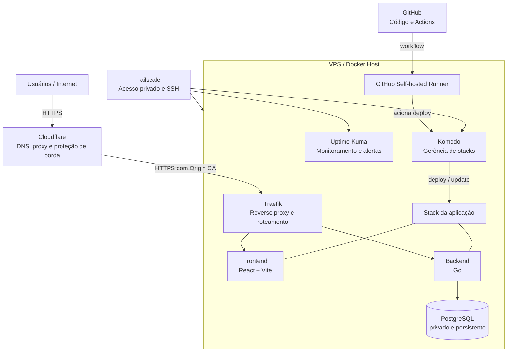
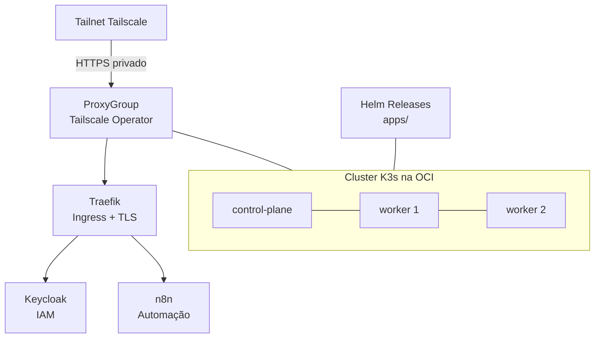

# DevOps Homelab

Infraestrutura auto-hospedada em dois ambientes: uma **VPS Docker** para publicar aplicações web com HTTPS, deploy automatizado e monitoramento, e um **cluster K3s na Oracle Cloud** em HA com acesso zero-trust via Tailscale.

O objetivo é manter plataformas simples de operar, sem abrir ferramentas de administração ou o banco de dados para a internet.

## Arquitetura



### Cluster OCI (K3s)



## Componentes

| Componente | Responsabilidade | Exposição |
| --- | --- | --- |
| Cloudflare | DNS, proxy, TLS de borda e proteção | Pública |
| Traefik | Terminação TLS na origem e roteamento para containers | Pública, somente HTTPS |
| Frontend | Interface web em React e Vite | Pública via Traefik |
| Backend | API da aplicação em Go | Via Traefik quando necessário |
| PostgreSQL | Persistência de dados | Privada, acessível apenas pelo backend |
| Komodo | Gerência de stacks, deploys, updates e restarts | Privada via Tailscale |
| GitHub Actions | Build, release e orquestração do deploy | GitHub |
| Self-hosted Runner | Executor interno dos workflows de deploy | Privado na VPS |
| Uptime Kuma | Health checks, monitoramento e alertas | Privado via Tailscale |
| Tailscale | Acesso seguro à VPS e às ferramentas administrativas | Dispositivos autorizados |

## Fluxos principais

### Tráfego da aplicação

1. O usuário acessa o domínio pela internet.
2. A Cloudflare resolve o DNS, aplica a proteção de borda e encaminha o tráfego HTTPS.
3. O Traefik recebe a requisição na VPS usando um certificado Cloudflare Origin CA.
4. O Traefik encaminha a requisição para o frontend ou backend correto.
5. Apenas o backend pode se conectar ao PostgreSQL pela rede privada.

### Deploy

1. Uma alteração chega à branch de deploy no GitHub.
2. O GitHub Actions executa validações, build e publicação da imagem.
3. O workflow é executado pelo self-hosted runner dentro da infraestrutura.
4. O runner solicita ao Komodo a atualização da stack.
5. O Komodo atualiza os containers e mantém o ciclo de vida da aplicação.
6. O Uptime Kuma verifica a disponibilidade após o deploy e envia alertas em caso de falha.

### Acesso administrativo

1. O administrador entra na tailnet pelo Tailscale a partir de um dispositivo autorizado.
2. O acesso SSH à VPS e às interfaces do Komodo e Uptime Kuma ocorre pela rede privada.
3. Nenhuma ferramenta administrativa precisa ser exposta diretamente à internet.

## Princípios de segurança

- O PostgreSQL não publica portas para a internet.
- Serviços administrativos usam acesso privado via Tailscale.
- O Traefik só expõe serviços declarados explicitamente por labels Docker.
- Todo tráfego público utiliza HTTPS; a conexão Cloudflare → VPS usa Origin CA.
- Segredos ficam fora do Git: `.env`, tokens, certificados, chaves e backups são ignorados.
- Imagens, dependências e workflows devem ser versionados e revisados antes do deploy.

## Estrutura planejada

```text
.
├── ansible/             # Provisionamento e configuração da VPS
├── compose/             # Stacks Docker por serviço (VPS)
│   ├── traefik/
│   ├── postgres/
│   ├── monitoring/
│   └── application/
├── oci/                 # Cluster K3s na OCI (HA + zero-trust) — ver oci/README.md
│   ├── cluster/
│   ├── networking/      # Traefik + Tailscale Operator/ProxyGroup
│   ├── apps/            # Helm releases (Keycloak, n8n)
│   └── scripts/         # Coleta de manifests do servidor (pull-from-server.sh)
├── docs/                # Diagramas, runbooks e decisões técnicas
├── scripts/             # Backup, manutenção e validações operacionais
└── .github/workflows/   # CI, build e deploy
```

## Operação

| Rotina | Objetivo |
| --- | --- |
| Monitoramento | Acompanhar disponibilidade do frontend, API, proxy, banco e certificado TLS. |
| Backup | Gerar e testar backups periódicos do PostgreSQL e dos volumes persistentes. |
| Atualizações | Atualizar imagens e dependências de forma controlada, com possibilidade de rollback. |
| Revisão de acesso | Revisar dispositivos, ACLs e chaves do Tailscale regularmente. |
| Recuperação | Manter runbooks para reconstrução da VPS e restauração dos dados. |

## Estado do projeto

O repositório começa pela documentação da arquitetura. A implementação será adicionada incrementalmente: provisionamento da VPS, redes Docker, Traefik, banco, stack da aplicação, CI/CD, acesso privado, monitoramento e rotinas de backup.

## Próximas etapas

- [ ] Inicializar o repositório Git e publicar no GitHub.
- [ ] Provisionar a VPS com Docker e acesso via Tailscale.
- [ ] Configurar Cloudflare e Traefik com Origin CA.
- [ ] Subir PostgreSQL privado com backup automatizado.
- [ ] Adicionar a stack frontend, API em Go e migrations.
- [ ] Configurar Komodo, runner self-hosted e GitHub Actions.
- [ ] Configurar monitores e alertas no Uptime Kuma.
- [ ] Documentar operações, rollback e recuperação de desastre.
- [ ] Coletar manifests do K3s na OCI (`oci/scripts/pull-from-server.sh`) e revisar em `local-export/`.

## Aviso sobre segredos

Nunca faça commit de arquivos `.env`, tokens da Cloudflare ou GitHub, chaves do Tailscale, certificados TLS, credenciais de banco, dumps ou diretórios de dados persistentes.
